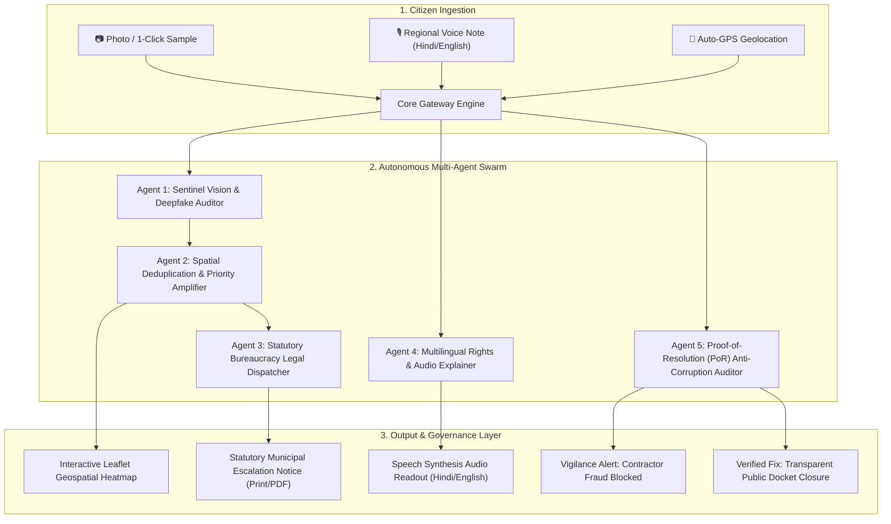

# 🏛️ CIVIC-NEXUS (Nagarik-OS)
### *Autonomous Multimodal Civic Governance, Spatial Triage & Anti-Corruption Engine*
**Built for the IDEA//FORGE Online Hackathon (Track 1: Civic Pulse & Digital Governance)**

---

## ⚡ 30-Second Elevator Pitch (For Interviewers & Judges)

> *"Most government grievance portals in India are digital black holes—citizens face 50-field forms in English, municipal engineers get drowned in duplicate complaints for the exact same pothole, and billions of public funds are stolen through fake contractor repair claims.*  
> ***CIVIC-NEXUS*** *is an autonomous multi-agent operating system that allows any citizen to simply take a photo and speak in their regional language. Our AI verifies the photo against deepfakes, calculates hazard severity (1-10), clusters nearby duplicate complaints with geospatial math, dispatches formal legal notices to municipal engineers, and uses computer vision diffing to stop contractor fraud before any public funds are released."*

---

## 🎯 What is the Use of This Project? (Real-World Applications)

CIVIC-NEXUS serves 4 distinct real-world stakeholders in civic administration:

| Stakeholder | Real-World Use Case | Real-World Value |
| :--- | :--- | :--- |
| 🧑‍🤝‍🧑 **Everyday Citizens** | Snap a photo of a dangerous road, garbage dump, or broken pipe and speak in Hindi/English. | **Zero typing, zero bureaucratic confusion.** Takes 5 seconds, works on low-end smartphones. |
| 👷 **Municipal Ward Engineers** | Receive prioritized, deduplicated daily work orders with statutory legal SLA deadlines. | **Stops duplicate spam.** 20 complaints about one pothole are merged into a single actionable ticket. |
| 🛡️ **State Vigilance Officers** | Automated audit engine flags fraudulent repair claims submitted by contractors. | **Stops corruption.** Prevents contractor payment payouts on fake or temporary mud fixes. |
| ⚖️ **Legal & Human Rights Bodies** | Citizens learn their compensation rights under High Court directives and Article 21. | **Legal empowerment.** Simplifies complex laws into audio in regional languages. |

---

## 🚀 Key Advantages Over Existing Portals

| Feature | Traditional Portals (CPGRAMS / Municipal Apps) | CIVIC-NEXUS (Our Solution) |
| :--- | :--- | :--- |
| **Filing Interface** | Manual 30-50 text fields, dropdowns, English only | **Zero-form**: 1 photo + voice note in regional language |
| **Media Verification** | Accepts any internet image or meme without check | **Deepfake & EXIF Sensor Audit**: Blocks AI & stock photos |
| **Duplicate Reports** | Creates 50 individual tickets for 1 pothole | **Geospatial Haversine Clustering**: Merges nearby reports |
| **Prioritization** | First-Come-First-Served (ignores hazard danger) | **AI Severity Matrix (1-10)**: Deadly hazards handled first |
| **Remediation Audit** | Contractor marks "Fixed" with no verification | **AI Proof-of-Resolution (PoR)**: Visual Before vs After diff |
| **Citizen Rights** | None (citizens don't know compensation bylaws) | **Audio Rights Explainer**: Multilingual Speech Synthesis |

---

## 🧠 System Architecture & Multi-Agent Swarm



---

## 🎤 How to Explain This Project in an Interview (Talking Points)

When an interviewer asks: *"Tell me about your project and your technical contributions,"* follow this structured framework:

### 1. The Problem Statement (20 seconds)
> *"I built CIVIC-NEXUS to solve systemic failures in civic governance. The core issue isn't just taking complaints; it's triage, deduplication, and verification. Traditional portals treat a deadly open manhole the same as a cosmetic wall crack, and they have zero automated checks to stop contractors from submitting stock photos to claim repair funds."*

### 2. The Technical Architecture (30 seconds)
> *"I designed an autonomous multi-agent architecture using Python and modern web standards:
> - **Vision Agent:** Uses multimodal computer vision to segment damage, check camera sensor EXIF authenticity against AI deepfakes, and assign a 1-10 physical danger score.
> - **Spatial Clustering Engine:** Uses the geodesic Haversine formula to cluster reports within a 40-meter radius, elevating community priority rather than spamming ward engineers with duplicates.
> - **Bureaucracy Agent:** Automatically maps GPS coordinates to administrative wards and drafts formal notices citing state Municipal Corporation Acts.
> - **Proof-of-Resolution (PoR) Auditor:** A visual diffing model that compares the Before-repair hazard with the After-repair photo to catch contractor fraud."*

### 3. Engineering Decisions & Trade-Offs (High-Scoring Answers)
* **Q: Why Haversine Clustering instead of a heavy spatial database like PostGIS?**
  * *Answer:* *"For edge latency and portability. Haversine allows sub-millisecond proximity matching in memory without needing heavy GIS servers, making the system runnable on lightweight microservices."*
* **Q: How does the system handle non-English speaking citizens?**
  * *Answer:* *"We integrated the Web Speech Synthesis API and multimodal speech transcription so citizens can dictate their grievance in Hindi or English, and listen to their statutory legal rights read aloud."*
* **Q: What if the API is down or internet bandwidth is low?**
  * *Answer:* *"I implemented a dual-engine architecture: a live Google Gemini 2.0 Flash engine, backed by a deterministic heuristic forensic fallback, so the application never fails even in offline or constrained environments."*

---

## ⚡ How to Run Locally

### Option 1: Standalone Server (Zero pip packages needed!)
```powershell
cd backend
python standalone_server.py
```
Open **`http://localhost:8000`** in your browser.

### Option 2: Production FastAPI Mode
```powershell
cd backend
pip install -r requirements.txt
uvicorn main:app --reload --port 8000
```

---

## 💻 Tech Stack Summary

* **Frontend:** Responsive Executive Gov-OS UI, Tailwind CSS, Leaflet OpenStreetMap Engine, Lucide Icons, Web Speech Synthesis API.
* **Backend:** Python 3.13, FastAPI / Built-in Standard HTTP Server, Pydantic, Google Gemini 2.0 Flash Vision.
* **Algorithms:** Geodesic Haversine Proximity Clustering, Semantic Image Diffing, Media EXIF Forensic Verification.

---

## 👥 Hackathon & Repository Details
* **Hackathon:** IDEA//FORGE Online Hackathon
* **Track:** Track 1: Civic Pulse, Digital Governance & Public Information
* **GitHub Repository:** [https://github.com/narasimhuluchakali739-gif/CIVIC-NEXUS-Nagarik-OS-](https://github.com/narasimhuluchakali739-gif/CIVIC-NEXUS-Nagarik-OS-)
