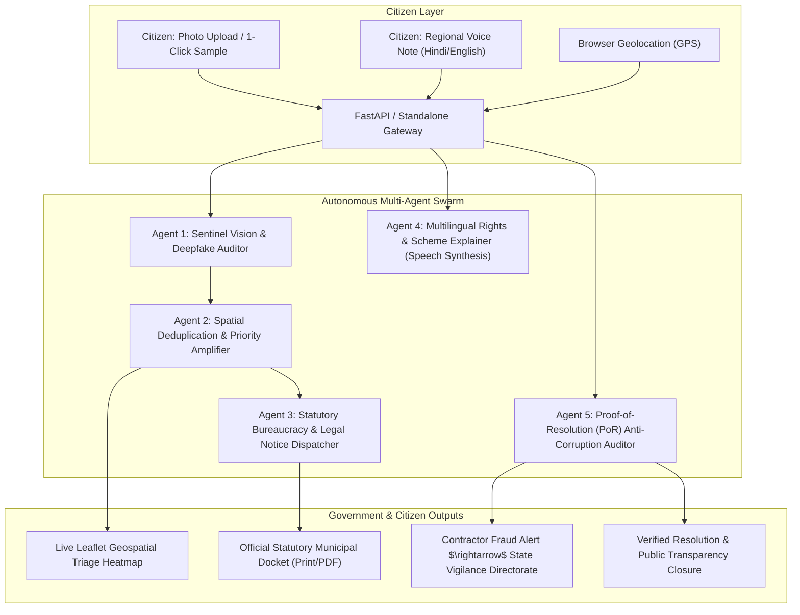

# 🏛️ CIVIC-NEXUS (Nagarik-OS)
### *Autonomous Multimodal Civic Governance, Spatial Triage & Anti-Corruption Engine*
**Built for the IDEA//FORGE Online Hackathon (Track 1: Civic Pulse & Digital Governance)**

---

## 📌 Executive Summary
**CIVIC-NEXUS** is an autonomous multi-agent operating system designed to eliminate the 4 greatest bottlenecks in Indian municipal governance:
1. **Friction-heavy 50-field forms** that exclude non-English speaking citizens $\rightarrow$ Solved via **Multimodal Photo & Regional Voice Ingestion**.
2. **Duplicate report spam** for the same physical road pothole or sewage leak that overwhelms ward engineers $\rightarrow$ Solved via **Geospatial Haversine Deduplication (40m radius)**.
3. **Contractor corruption & fake repairs**, where public funds are disbursed for repairs that were never done $\rightarrow$ Solved via **Computer Vision Proof-of-Resolution (PoR) Diffing**.
4. **Information asymmetry & lack of rights awareness**, where citizens don't know their compensation rights under High Court directives $\rightarrow$ Solved via an **AI Rights Explainer with Speech Synthesis**.

---

## ⚡ Quick Start (Run in 5 Seconds)

### Option 1: Zero-Dependency Standalone Mode (No pip needed!)
```powershell
cd backend
python standalone_server.py
```
Open **`http://localhost:8000`** in your browser.  
*(Works 100% natively on any locked-down Windows PC).*

### Option 2: FastAPI Production Mode
```powershell
cd backend
pip install -r requirements.txt
uvicorn main:app --reload --port 8000
```

---

## 🌟 Core System Architecture



---

## 🚀 Key Features

### 1. Zero-Form Ingestion with Real-Time Deepfake Audit
* Citizens snap a photo and dictate a voice note in regional languages (Hindi/English).
* The **Sentinel Vision Agent** verifies camera sensor EXIF metadata to ensure the image is a genuine live hazard, rejecting AI-generated deepfakes (Midjourney/DALL-E) or stock photos.
* Calculates physical hazard severity (**1 to 10**) and mandates statutory SLA completion deadlines (12h, 24h, 48h).

### 2. Geospatial Haversine Clustering (Zero Duplicate Spam)
* If 15 citizens report the same pothole on the same road, the system uses geodesic math to cluster them within a 40-meter radius into a **single high-priority docket**.
* Rather than spamming the municipal department with 15 duplicate tickets, it amplifies the community urgency rating.

### 3. Statutory Legal Notice Generation & PDF Export
* The Bureaucracy Agent maps coordinates to simulated local wards (e.g., BBMP Ward 150) and drafts formal statutory notices citing relevant clauses of the **Municipal Corporation Act** (e.g., Section 284) and the **Indian Electricity Act 2003**.
* Features one-click **Print / PDF Statutory Docket Export** with verification watermarks.

### 4. Multilingual Rights & Scheme Explainer with Voice Readout
* Democratizes legal knowledge by explaining citizen compensation rights (e.g., medical reimbursement rights for pothole accidents under High Court directives and Article 21).
* Features built-in **Speech Synthesis (`🔊 Hindi Voice` and `🔊 English Voice`)** that reads citizen rights aloud.

### 5. Proof-of-Resolution (PoR) Anti-Corruption Lab
* When a municipal contractor marks a ticket "Fixed", they must submit an "AFTER" repair photo.
* The PoR Vision Agent performs semantic image comparison. If the contractor uploads a fake photo or stock image, it stamps **`CONTRACTOR_FRAUD_FLAGGED`** and escalates directly to the State Vigilance Directorate.

---

## 📁 Repository Directory Structure

```text
civic-nexus/
├── backend/
│   ├── main.py              # Central FastAPI Gateway & API endpoints
│   ├── standalone_server.py # Zero-dependency Python standard library server
│   ├── vision_agent.py      # Gemini 2.0 Flash Multimodal Vision & Deepfake Auditor
│   ├── spatial_engine.py    # Haversine geodesic clustering (40m radius)
│   ├── bureaucracy_agent.py # Statutory notice generator citing Municipal bylaws
│   ├── por_auditor.py       # Proof-of-Resolution Before-vs-After forensic diffing
│   ├── database.py          # Thread-safe in-memory store for dockets & audit trails
│   ├── seed.py              # Real metropolitan hazard seed generator (Bangalore/Delhi)
│   ├── test_output.py       # Instant terminal verification script
│   ├── requirements.txt     # Python dependencies
│   ├── .env.example         # Environment template
│   └── static/
│       └── index.html       # Full dark-mode Executive Command Center UI
├── PITCH_SCRIPT.md          # 2-minute word-for-word demo script & judge Q&As
├── run.bat                  # One-click Windows launcher
└── run.ps1                  # PowerShell launcher
```

---

## 👥 Hackathon Submission Details
* **Hackathon:** IDEA//FORGE Online Hackathon
* **Track:** Track 1: Civic Pulse, Digital Governance & Public Information
* **Team Repository:** [https://github.com/narasimhuluchakali739-gif/CIVIC-NEXUS-Nagarik-OS-](https://github.com/narasimhuluchakali739-gif/CIVIC-NEXUS-Nagarik-OS-)
